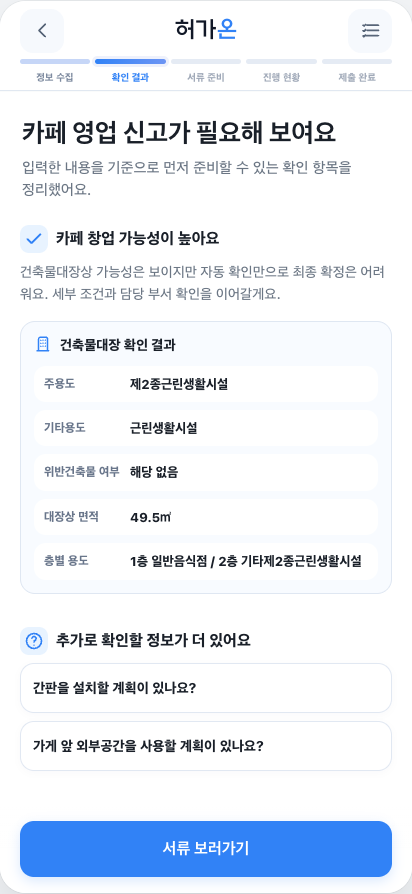
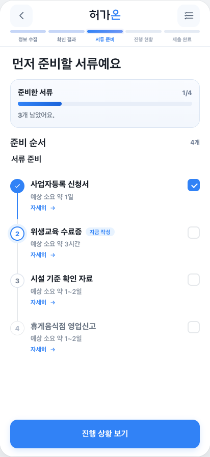

## 남주현

정밀 커넥터를 검사하고 자동화 설비 시운전을 도우며 제조 현장에서 일했습니다. 지금은 로봇과 설비에서 나오는 신호를 분석하고, 이상이 생겼을 때 어디부터 점검할지 보여주는 소프트웨어를 만듭니다.

### 경력 · 실습

- **한국생산기술연구원** · 협동로봇 현장실습 (2026~현재) · ROS 2로 UR30의 동작을 시험하고 드릴링 실험에서 재료별 가공음을 비교했습니다.
- **자동화 설비 시운전** (2023~2024) · PLC 설비 설치와 시운전을 지원하며 센서 신호와 실제 동작을 대조했습니다.
- **정밀 커넥터 생산·검사** (2020~2021) · 현미경으로 휨과 버를 확인하고 치수를 도면 공차와 비교했습니다.

### 학력 · 교육

- 소프트웨어융합공학 전공 · 2027년 2월 졸업 예정
- 정밀기계 전공(고교) · 반도체시스템 전공 과목 이수 · 경영학사 취득
- **삼성청년SW·AI아카데미(SSAFY) 15기** · AI 트랙 1학기 이수(925시간)

## 프로젝트

### 🤖 [무인운반로봇 진단·관제 ↗](https://github.com/JuHyeon-Nam/ServiceRobot_AI) &ensp;<code>FastAPI</code> <code>LightGBM</code>

로봇 한 대를 고르면 어떤 센서부터 점검할지 보여주는 관제 화면을 만들었습니다. 배터리와 주행 기록으로 고장 유형을 분류하고, FastAPI로 진단 결과와 근거가 된 센서 항목을 함께 보냅니다. [38초 시연](https://github.com/JuHyeon-Nam/ServiceRobot_AI/blob/main/assets/twin_walkthrough.mp4) · [모델 평가](https://github.com/JuHyeon-Nam/ServiceRobot_AI/blob/main/docs/MODEL_CARD.md)

| 로봇 관제 화면 | 고장 진단에 쓰인 센서 특징 |
| :---: | :---: |
|  |  |

### 📊 [반도체 공정 불량 탐지 ↗](https://github.com/JuHyeon-Nam/semiconductor-process-fault-detection) &ensp;<code>scikit-learn</code> <code>pandas</code>

불량을 더 많이 잡을 때 오경보가 얼마나 늘어나는지 SECOM 데이터로 비교했습니다. 선택한 기준으로 테스트한 결과, 불량 21건 중 16건을 찾았고 정상 66건에도 경보가 울렸습니다. [평가 결과](https://github.com/JuHyeon-Nam/semiconductor-process-fault-detection/blob/main/reports/model_card.md)

| 경보 기준에 따른 성능 | 불량 탐지와 오경보 건수 |
| :---: | :---: |
|  |  |

### 🏆 [SSAFY AI 챌린지 ↗](https://github.com/JuHyeon-Nam/Recycle_VQA_Challenge) &ensp;<code>InternVL</code> <code>PyTorch</code>

사진 속 물건의 개수나 재질을 묻는 문제에서 InternVL 실험을 맡았습니다. 팀원과 두 모델의 오답을 질문 유형별로 비교해 최종 답안을 정했고, **193개 팀 중 1위로 최우수상**을 받았습니다.

| 최우수상 시상식 | 최종 순위표 |
| :---: | :---: |
|  |  |

### 💳 [카치 · 카드 혜택 비교 ↗](https://github.com/whtjddlr/carch) &ensp;<code>Vue 3</code> <code>REST API</code>

같은 소비 내역을 내 카드와 추천 카드로 결제하면 혜택이 얼마나 달라지는지 보여주는 서비스입니다. Vue로 소비 분석 화면을 만들고 팀원이 개발한 API를 연결했습니다.

| 보유 카드 | 월별 소비 분석 |
| :---: | :---: |
|  |  |

### 🔬 [Wafer AI Analyst ↗](https://github.com/JuHyeon-Nam/wafer-ai-analyst) &ensp;<code>pandas</code> <code>Streamlit</code>

측정 장비가 내보낸 CSV와 엑셀 파일을 읽는 코드를 작성했습니다. 다이오드, 저항 등 소자별 측정 곡선과 이상 후보를 Streamlit 대시보드에서 살펴볼 수 있도록 연결했습니다.

| 측정 결과 요약 | 소자별 측정 특징 |
| :---: | :---: |
|  |  |

### 📋 [허가온 · 창업 인허가 안내 ↗](https://github.com/JuHyeon-Nam/HEOGAON) &ensp;<code>시나리오 테스트</code> <code>AI 응답 검증</code>

창업 조건에 맞춰 필요한 서류를 안내하는 팀 프로젝트에서 AI 답변 검증을 맡았습니다. 판매 품목이나 시설 정보가 빠졌을 때 서비스가 되묻는지, 안내한 서류에 근거가 있는지 확인했습니다. [시연 영상](https://youtu.be/qiv1yjfYUZQ)

| 창업 인허가 진단 | 준비 서류 안내 |
| :---: | :---: |
|  |  |
